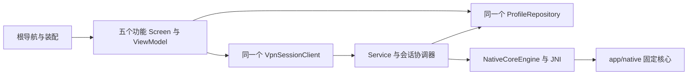

# Chuanmen 技术架构与关键契约

架构设计基线 1.0 · 外部资料核对日期：2026-10-11（Asia/Shanghai）。文中的上游“当前/最新”按该日期理解，实际依赖以仓库配置为准。

本文规定状态归属、平台适配与验证门槛。P02 已建立正式 bridge 与 Service；现行单模块边界见 [ADR 0005](adr/0005-single-app.md)，构建见 [开发环境](../development/setup.md)，阶段与验证范围见 [路线图](../plan/ROADMAP.md)。

本文的证据等级为：**已证实**指研究时读取的一手文档或固定版本源码；**拟议**指本项目应建立的设计与接口；**待实测**指必须由所选构建产物与设备实验确认的行为。读取记录见 [Android 与核心证据](../research/android-core-evidence.md)，后续实测结果见 [P00 报告](../verification/p00/report.md)；源码事实不能代替产品验收。

## 1. 架构结论

采用 **Kotlin + Jetpack Compose + Android VpnService + 固定版本 EasyTier Rust 核心**。应用通过本项目的窄 JNI 桥访问核心，由服务统一持有运行会话；页面通过类型化状态观察服务。初期使用单进程、单个活动 VPN 会话，允许保存和编辑多个网络配置。

核心优先复用上游 `easytier` 原生宿主、实例管理和 `easytier-contrib` 中的 FFI/JNI 能力。不要为了界面重写组网协议，也不要直接依赖不断变化的 Rust 内部类型到每个 ViewModel。`easytier-core` 在研究时主干已拆为便携核心，直接嵌入它还意味着承担宿主适配责任；本项目先复用完整原生宿主，再补 Android 必需的边界。P00 已提供该方向的限定构建与真机依据，正式接入和补丁仍须产品评审。[ET-01]、[ET-04]

### 1.1 上游版本必须先选定一份

| 2026-10-11 读取对象 | 研究时已证实状态 | 对本项目的影响 |
|---|---|---|
| 最新非预发布 `v2.6.4` | 2026-05-12 发布；标签当前指向 `8428a89d2dabc94c97d370ec607c6ca142473626` | 作为稳定发布比较基线；不能假设有主干新接口 |
| 当前 `main` | `7592951b808c4839cb9d77cc4bc642f124915951`，提交时间 2026-10-10 17:35:33 UTC；manifest 的核心版本为 `2.7.0` | 是研究快照，不能当作已发布的稳定 2.7.0 |
| 原型配置语义快照 | 原型目录记录 `83baead0599110bee0d47f4c70b63b23753252a7`，官网部署另以文件 SHA-256 固定 | UI 范围证据与本次核心主干不是同一份版本 |

P00 的固定核心来源、实验补丁决策与遗留限制以报告为准。正式接入须绑定明确来源，核对补丁批准、回退和回归安排；桥接契约、默认值、配置编码、构建 features 和测试 fixture 都绑定该来源。不得用稳定版 `.so` 配合主干 RPC schema，也不得把官网 UI 自动等同于所选核心版本。[ET-01]、[ET-02]、[ET-03]

## 2. 工程边界与依赖

仅保留 `:app`，基础包为 `com.github.zzwtsy.chuanmen`。功能代码聚合在 `features/<功能>`，共享能力按实际消费者进入根 `lib`、`components`、`utils`，主题保留 `ui/theme`。详细边界见 [ADR 0005](adr/0005-single-app.md)。

| 目录 / 所有者 | 职责 |
|---|---|
| 根六个 Kotlin 文件 | Activity、Application、装配、导航、查看身份、顶栏摘要及主题 |
| `features/configuration` | 草稿、模式、保存、改名、待应用和实际配置恢复；独占编辑器 |
| `features/overview` | 查看/运行归属、连接动作、真实地址、在线数与 60 秒流量投影 |
| `features/devices` | 当前会话观测匹配、在线设备、路由、NAT 与缺测投影 |
| `features/logs` | 真实生命周期与核心诊断的完整来源、原有格式和顺序 |
| `features/settings` | 更新共享外观偏好、只读展示当前查看配置的互联网范围 |
| `components` | 多个功能使用的复制 IP、指标、分组卡片与条件操作区；不读取仓库或提交命令 |
| `lib/profile` | 配置身份、原始 TOML 文档、已保存修订、加密持久仓库及窄仓库所有者接口 |
| `lib/vpn` | 唯一真实会话、Service/JNI、TUN、授权、资源生命周期与真实采样 |
| `lib/AppearancePreferences`、`utils/Ipv4` | 根与设置共享的外观对象；跨能力复用的纯 IPv4 校验 |
| `app/native` | 固定上游来源、必要补丁、Rust 桥与原生回归 |
| `app/src/test`、`app/src/androidTest` | 按功能/共享能力镜像组织的 JVM/Compose 测试和真实设备契约 |

每个功能的 Screen 渲染自己的 UiState 和回调；ViewModel 负责业务投影。功能动作直接交给所属 ViewModel，跨页导航回调由根处理；根不持有草稿、整份会话、流量、日志、待应用或功能消息。

根与五个功能 ViewModel 在同一个 Activity owner 下以稳定键创建，不按查看身份重建。根仅向功能传只读查看身份流及必要的共享依赖，不注入其他 ViewModel。配置动作处理当下读取当前查看 ID，并确保编辑器已经打开该草稿；快速切换不会编辑旧对象。草稿按配置 ID 保留，页面/设置切换和配置重建不丢失原始输入或错误。

Application 持有唯一仓库及 lazy 客户端。Service 通过 `ProfileRepositoryOwner` 核对保存修订，继续唯一拥有真实会话。主题和设置共享 Application 的同一个外观偏好对象；外观与最后查看身份从非敏感 SharedPreferences 恢复。订阅展示状态不增加真实采样器，清理 ViewModel 不停止 Service。

实体 source set 只有 main/test/androidTest；debug/release 共用正式配置入口，无应用侧演示数据或 Preview。初次保存不连接，显式连接完成授权、校验与连接目标落盘后才进入真实核心；保存通过进程唯一仓库加密落盘，加载失败保留原文件。

### 2.1 为什么先单进程

Android 默认让应用组件处于同一进程；Service 不自动拥有专用线程。独立 `:vpn` 进程可隔离 UI 与 native 崩溃，但会增加 Binder 协议、进程死亡重绑定、数据库跨进程访问、回调背压和两套状态恢复成本。[A-08]

本项目先用同进程、独立服务作用域、串行会话控制器、后台 JNI 调度。UI 关闭和 Activity 重建不结束服务会话。只有 P00/P06 的崩溃实验、长时运行数据或明确产品要求证明隔离收益后，才引入独立进程；届时增加 ADR，禁止以静态单例“共享”两个进程的状态。无论是否分进程，native 的 release panic/崩溃都不能靠 Kotlin `try/catch` 当作已恢复；UI 必须能从实际服务状态重新建立显示。

## 3. 数据模型：本地名称、保存内容与运行内容分开

### 3.1 配置身份

| 概念 | 建议模型 | 规则 |
|---|---|---|
| 本地配置 ID | `LocalProfileId`，随机 UUID | 永久主键；重命名不变 |
| 本地配置名称 | `LocalProfileMetadata.localDisplayName` | 仅供本机识别；新建可空，留空使用网络名称；修改不触发重连 |
| EasyTier 网络名称 | `CoreConfigDocument` 由 `network_identity.network_name` 解析出只读 `CoreConfig.networkName` | 入网参数；与本地显示名独立 |
| 本设备名称 | `CoreConfig.hostname` | 对等设备看到的名称；本轮改变后通过受控重连应用 |
| 核心实例标识 | `CoreInstanceId` / 内部实例名 | 由适配层管理且稳定映射 LocalProfileId，不使用用户可改显示名作为句柄 |
| 运行会话 | `SessionId` + `generation` | 每次连接或受控重连换代；所有异步响应带代号 |

原型 `profile.label` 在原生工程中只映射到 `LocalProfileMetadata.localDisplayName`，不同时保留 `displayName` 或 `label` 作为第二份可写字段。重命名只更新元数据事务。还原上次运行配置、导入核心 TOML、丢弃草稿，都不得覆盖用户自己起的本地名称。复制配置生成新的 LocalProfileId；导入时不能让文件中的 `instance_name` 直接接管内部句柄。

创建和编辑共用 `RawConfigurationInput`、类型化字段目录与输入工厂。节点行的 `PeerRowId` 只存在于草稿，补丁以原数组索引明确保留、替换或插入，未引用的原节点才被删除。Rust 复制完整原节点以保留未知成员；未知成员仍阻止运行。

保存提交以独立 `SaveToken` 识别请求，以草稿代次和编辑序号识别后续输入。保存中可继续编辑，丢弃/重载需等待回执；新建首次提交锁定表单。创建页与已有编辑页使用同一 Activity 配置 ViewModel，秘密不进入 Bundle、SavedStateHandle 或磁盘草稿。运行比较使用固定核心解析后的有效值，源语义比较仍保留缺省、空值和未知字段。

### 3.2 四类状态

| 状态 | 来源与生命周期 | UI 使用方式 |
|---|---|---|
| `DraftConfig` | 当前编辑内容、原始输入文本、字段错误；允许暂时无效 | 基础配置与完整配置共享同一份草稿 |
| `SavedConfig(revision)` | 已完成校验并持久化的配置与 Android 策略 | 用于下次连接；保存不等于运行生效 |
| `AppliedConfig(revision, sessionId)` | 服务确认当前会话实际使用的配置版本 | 用于比较“待应用”；断开或应用结果未知时不继续作为当前事实，确认规则见 §4.3 |
| `SessionSnapshot` | 服务与核心回执、TUN 状态、采样时间、连接路径 | 首页连接状态与设备状态的唯一运行来源 |

P03 存储采用 AtomicFile + 版本化 JSON + Keystore AES-GCM 保存配置，密文位于 noBackupFilesDir；不引入 Room/DataStore。元数据、原始核心文档、Android 策略和最后明确连接目标一起原子提交；提交成功才发布内存快照。非敏感外观偏好与最后查看 ID 使用 SharedPreferences，最后查看 ID 不能作为自动连接目标。已有密文只允许获取原密钥，密钥不可用时阻止写入并保留密文与最近成功快照。仓库以候选树生成编码字节，原子落盘成功才发布该候选快照；改名与连接目标更新不重新解析全部 TOML。codec 由 Application 显式装配，仓库接口不暴露 codec。完整接口和错误语义见 [P03](../plan/p03-configuration.md)。

schemaVersion 为 1；完整 JSON 明文上限 8 MiB，单项 TOML 上限 128 KiB，JNI 编码后上限 256 KiB。AES-256-GCM 使用每次独立 12 字节 IV、128 位认证标签和版本头 AAD。读取只使用已有 Keystore 密钥，密钥缺失不重建覆盖；AtomicFile 提交成功后才发布 Ready/最新快照。写接口使用 suspend、明确 WriteResult 与 expectedRevision 比较；元数据合并，相同解析值不增加修订，排版变化仍保存原文。没有生产旧磁盘格式，不实现 schema 0 迁移。

原始 TOML 是唯一可保存源，字段投影只读；parse/patch/runtime 编码共用唯一 .so 和固定核心解析器。未知字段、日期、u64、显式 false/空列表保留，未接入项阻止运行；u64 以十进制字符串穿过 JNI。托管字段只在运行输出覆盖并提供脱敏 key 预览。当前宿主补丁 `p04-observability-host-v1` 保留 P03 的显式 IPv4 前缀适配（含 /32，裸地址沿用 /24），将 TUN 成功/失败计量判断统一到可回归入口；来源 commit 未升级，补丁前后摘要见 app/native/inputs.json。运行比较排除排版、本地名称、托管参数及来源身份字段。

仅保存已保存版本；草稿在切页和旋转时保留，进程退出后丢弃。秘密不进入 SavedStateHandle、Bundle、日志或测试真实凭据。密钥失效、认证失败、损坏及未来 schema 保留原文件并报告读取失败，不能自动初始化为空。配置与日志从系统备份和设备迁移中排除；用户显式备份由 P05 的 age 口令加密导出提供。[A-15]

本轮全部配置运行变更采用受控重连，不新增字段热应用白名单；下文应用事务由 Service 统一执行。

## 4. 会话状态机与配置应用

状态建议包含 `Idle`、`AwaitingPermission`、`StartingCore`、`PreparingTun`、`Running`、`Reconnecting`、`Stopping`、`Failed`。`Running` 表示本机核心与 VPN 数据路径已准备完成，不保证已经找到其他设备，也不保证任意目的地址可达；“等待设备加入”是它的一种正常内容状态。

会话控制器按命令串行执行 `Connect(profileId)`、`Disconnect`、`Apply(savedRevision)`、`UnderlyingNetworkChanged`、`Revoke`，每条命令具有操作 ID。反复点击连接合并为同一操作；过期的启动回执、指标和日志不能覆盖新会话。

P03–P06 对恢复目标使用以下约束：持久化的 lastConnectionTarget 与 UI viewedProfileId、进程内 desired 分开。用户授权且连接校验通过后，先原子保存目标再发 Start；目标写失败不启动。普通停止清除 desired 和重试，不删除 lastConnectionTarget；删除配置时同时删除目标引用。新的系统 Always-on 启动属于新的明确系统意图，可以读取该目标，但普通 App/Service 重建不能自行恢复。

### 4.1 连接事务

1. 取得保存版本，执行 App 语义校验与所选核心的解析验证；检查构建能力和平台策略。
2. 由 UI 完成 `VpnService.prepare()` 的系统授权流程。拒绝后返回可重试状态，保留配置。
3. 从允许的用户操作或系统路径启动前台服务，及时建立持久通知；核心的阻塞初始化不在主线程执行。
4. 安装 Android socket protection 能力，启动一个核心实例。保护钩子必须在可能创建外层连接前就绪。
5. 等待可信的本机地址和有效路由方案；DHCP 成功与端口监听成功分别记录，不能从模拟 IP 或默认值推断。
6. 用 `VpnService.Builder` 建立 TUN，将 fd 借给核心，沿用现有 attachmentId 与 TunBorrowState 的 Installed 回执；不得把入队成功当作安装完成，也不重新设计第二套确认协议。
7. 只有核心启动、TUN 建立、对应代次的 fd 安装和平台参数应用均确认后，发布 Running 与 AppliedConfig；没有对等设备时展示等待状态。

每一步失败都有明确资源回收路径。不能把 `runNetworkInstance()` 或 `setTunFd()` 返回 0 当作整个连接事务成功。当前主干 `setTunFd()` 最终只是将 fd 放入异步安装队列；安装任务后续仍可能失败。[ET-03]、[ET-05]

### 4.2 应用配置的默认行为

保存和应用是两个显式动作：保存执行**校验 → 原子提交 → 发布 saved**，不发送会话命令；应用只接受已保存修订，执行**生成运行投影 → 受控重连 → 回执确认**。未保存草稿存在时禁用应用，不由应用按钮偷偷保存。这是为了得到可验证行为，不声称上游所有配置都能热更新。

当前主干存在 `ConfigRpc.PatchConfig`，但 patch 模型只列出部分字段，且 Android 地址、DNS、应用名单与 TUN 路由需要独立同步。稳定版是否可通过本项目桥调用、字段间是否事务一致、失败能否回滚，都必须逐项实测。本轮不建立 `liveApplyAllowlist`，不调用该接口做字段热更新；所有变更采用受控重连。[ET-09]

“仅保存”不更改活动会话；“应用”对当前活动配置的确定 saved 修订执行事务，本轮不新增合并的“保存并应用”动作。保存内容保留，运行状态按下节的确认程度发布。恢复上次运行版本应是明确操作，不静默丢弃用户修改；若恢复成功，以实际恢复回执更新状态。只有当前确实存在同配置的已确认活动会话，且已保存的核心配置或 VPN 策略与实际运行内容有差异，才显示“更改待应用”；仅修订号不同不构成内容差异。

配置页正常状态不显示“已应用”横条；未保存、待应用、错误或处理中才出现底部操作区。成功使用短暂反馈；失败与待处理状态持续可见。复制 IP 使用统一图标反馈，Android 13 及以上应避免与系统剪贴板反馈重复提示，原型 Toast 不能逐字照搬为双提示。[A-13]

### 4.3 应用结果的确认

会话事务区分以下三种结果，超时只说明未在预算内收到确认，不能单独证明核心没有执行：

| 结果 | 确认依据 | 运行快照与恢复 |
|---|---|---|
| 已确认成功 | 当前会话、操作和目标修订匹配的实际生效回执 | 更新 applied 与运行快照，发布成功 |
| 已确认失败 | 明确的拒绝或失败回执，并已确认失败后的实际会话状态 | 保留 saved 与草稿，如实表达旧会话仍在、已停止、恢复中或恢复失败；按确认结果提供重试或恢复 |
| 结果未知 | 核心可能已执行，但回执丢失或无法确认结果 | 上次确认快照只作历史，失去新鲜度；不发布成功或已确认失败，阻止再次应用，允许显式停止 |

结果未知时优先查询实际运行配置，与目标修订及当前会话核对。不能查询时，等待停止确认后受控重建，再发布新的运行快照；停止未获确认时不能重建。晚到回执仍须核对会话代次与操作归属，不能改变新会话。运行结果不确定不影响用户继续编辑或仅保存草稿。

这是会话事务与配置展示共用的契约；实现和设备验证范围分别以当前回归与 P02 报告为准。用户可见状态与动作见 [总体设计 §6.5](overall-design.md#65-按需操作区)。

## 5. TUN、socket 与网络变化的硬契约

### 5.1 fd 所有权

**本项目采用 Kotlin 持有、native 借用的所有权模型。**上游稳定版与本次主干的 mobile TUN 路径都设置 `close_fd_on_drop(false)`，这说明不能假设 native 析构会替 Kotlin 关闭 fd。[ET-06]

| 对象 | 所有者 | 必须满足的约束 |
|---|---|---|
| `ParcelFileDescriptor` | VpnService / TunCoordinator | 建立后保持强引用，负责最终关闭 |
| 借给核心的整数 fd | native 在当前代次内借用 | 禁止自行关闭或保存到下一代会话；桥文档写明借用期 |
| TUN 读取任务 | 单一 native 数据路径 | UI、Kotlin 图表和日志代码不得另开读取器 |
| TUN 写入任务 | 同一 native 路径 | 只统计成功写入的数据；失败不计为接收完成 |
| fd 替换 / 停止 | TunCoordinator 串行执行 | 停止旧读写并收到完成回执后，关闭旧 PFD；不得仅凭入队回执关闭 |
| 待安装队列 | native 会话宿主 | 取消和停止排空本代队列；入队成功不是安装成功，排空前继续保留 PFD |
| 外层传输 socket | native 创建和关闭；Service 只保护及绑定 | protect 和物理网络绑定均确认后才继续连接；旧会话回调拒绝放行 |
| JNI global reference | bridge 的会话资源作用域 | 停止等待在途回调结束，确认不再借用 PFD 后才释放引用 |
| 生命周期事件订阅 | Service 会话资源作用域 | 不随 Activity 关闭；停止超时仍保留终态订阅，确认收束后才取消 |
| 进程共享 runtime | native 进程宿主 | 会话停止不重复销毁或创建共享 runtime；资源回归核对预热后的固定基线 |

不要对 PFD 调用 `detachFd()` 后又继续按借用模型管理，也不要两边都 close。fd 是可复用整数；旧异步回调若在关闭后继续操作，可能误伤后来复用同一编号的资源。每次替换携带 sessionId、generation 和 attachmentId，完成回执只能匹配当前 attachment。

研究时上游 `setTunFd(-1)`/非正值路径可用于移除的内部行为不能自动当稳定公共协议。P00 的所有权观察只支撑限定探针；正式桥须明确提供 `detachTunAndAwait()` / `stopAndAwait()` 等语义并验证。如果无法安全证明关闭时序，P02 不得过关。

### 5.2 外层连接必须避免回环

Android `VpnService.protect(fd)` 用于让外层网络 socket 绕过 VPN；调用可能失败，并且不会替调用方关闭 socket。没有正确保护时，发往被 VPN 路由覆盖的地址可能重新进入 TUN，形成回环。[A-02]

本次主干已有 `NativeSocketProtector` Rust 钩子：它的 future 应在保护真正完成后返回；错误会阻止相应 socket 创建流程继续。但已读取的 JNI facade 没有对应的 Android callback 注册入口，而且未安装 protector 时内部函数会直接返回成功。因此 **“存在 protect 的 Rust 源码”不等于 JNI App 已受保护**。[ET-07]

本项目桥需要实现并验证：native 创建相关 socket → JNI 调用服务的 protect → 检查 Boolean 结果 → 返回确认 → 才继续 bind/connect/listen 或暴露 accepted socket。必须覆盖 TCP、UDP、重连、DNS/STUN、监听与接受连接、所启用的 QUIC/KCP 等路径；不能靠“排除 App 自身”掩盖漏掉的路径。保护失败和服务撤销必须使该次连接失败，不静默放行。

若需要将 socket 固定到具体物理网络，`Network.bindSocket()` 与 `setUnderlyingNetworks()` 是另一组职责；仅调用后者不会迁移现有 socket。官方说明应在实际底层网络集合改变时更新；默认不绑网络时其语义不同。[A-02]

### 5.3 路由、DNS、IPv6 与应用名单

`TunPlan` 是从已保存配置、核心实际地址/已学习路由和 Android 策略编译得到的**平台计划**，包含 address、routes、MTU、DNS、应用白名单或黑名单及 IPv6 策略。UI 不能把字符串直接逐条交给 Builder 而跳过语义校验。

应用允许名单与排除名单互斥，改变名单需要重新建立 VPN 连接；应用卸载后要显式处理缺失包名。网络地址或代理路由变化亦应进入相同的 TUN 协调路径；配置变化和 DHCP 变化不可同时建立两个相互覆盖的 TUN。[A-01]

IPv6 必须有可验证的支持或阻断策略，不能只显示一个“启用 IPv6”开关却不知道流量从哪出去。DNS 的系统、指定与核心名称解析需定义优先级，验证 VPN 内域名、系统 Private DNS、无 IPv6 网络、IPv6-only 网络和退出节点组合。路由覆盖只说明流量选择，不证明对端确实提供出口服务。

物理网络变化由 ConnectivityManager 回调汇入服务；去抖并丢弃过期事件。Wi-Fi ↔ 蜂窝切换、短暂断网、设备休眠都应先更新实际可用网络，再决定恢复连接。网络 `onAvailable` 不能替代能力与 LinkProperties 的后续变化；回调和同步查询之间的时序须测试。[A-11]

P05-06 的平台策略实现以该任务的逐项规则为准：应用名单使用 all/allowlist/denylist 互斥类型，失效包阻止名单策略应用；DNS system 从选定底层 Network 取上游，custom 使用用户明确的非空地址列表，禁止公共 DNS 回退；MagicDNS 与普通域名使用同一入口分域处理。IPv6 的底层传输、地址来源与 block/bypass/tunnel 分开，tunnel 缺地址/路由或 MTU<1280 时拒绝应用。任何策略先完整校验再创建 TUN，不能只成功应用其中一部分。

P06 把真实 isLockdownEnabled 注入同一策略校验器：lockdown+bypass 或 lockdown+非 all 名单返回 LockdownConflict。未实施 P06 前，P05 的模型测试注入该状态验证拒绝路径，不宣称系统状态已接入。详细输入和 Builder 断言见 [P05-06](../plan/p05-advanced-networking.md#p05-06--完成-android-路由与-dns-策略)与 [P06-07](../plan/p06-hardening.md#p06-07--执行状态组合回归)。

## 6. 本项目 CoreEngine 契约

以下为**拟议接口能力**，并非上游当前 JNI 已完整提供的方法名。

| 契约 | 最小输入 / 输出 | 验收重点 |
|---|---|---|
| `getBuildInfo()` | bridge ABI、core version、完整 SHA、feature 集合、schema 版本 | APK 与 native 来源一致；不兼容时明确报错 |
| `validateConfig()` | canonical TOML → 结构化结果 | 解析成功不替代 Android 语义与运行可行性校验 |
| `start()` / `stopAndAwait()` | 配置、SessionId → 生命周期事件 / 完成回执 | 同时最多一个活动实例；重复停止幂等 |
| `attachTunAndAwait()` / `detachTunAndAwait()` | 借用 fd、attachmentId → 安装或移除回执 | 明确借用期和失败回收；不等价于原始 setTunFd 的队列回执 |
| `setSocketProtector()` | 平台回调 → 安装状态 | 严格等待保护成功；回调不依赖 Activity |
| `observeSnapshot()` | 统一会话、本机信息、peers/routes、来源时间 | DTO 可缺失；当前快照有代次和单调序号 |
| `readTunCounters()` | 本机双向累计字节/包、采样时间 | 只有成功 TUN I/O 计数；计数重置可识别 |
| `observeCoreLogs()` | 有界日志事件流 | 背压、丢弃计数、脱敏、取消；不阻塞数据面 |

上游 JSON/protobuf DTO 只出现在 bridge 内。外层使用领域类型，未知枚举保留原值与 Unknown 展示；64 位累计值不先转成 Float/Double 再存储。JNI 的线程附着、全局引用释放、异常到错误类型的映射、字符串编码与回调取消都要有契约测试。

P02 已建立 `BridgeProtocol.VERSION=1`、`AttachmentId`、`VpnInterfaceSpec`、`TunInstalled`、`StopConfirmation`、`ConfirmationResult` 和 `RuntimeSnapshot`。`OperationResult.Accepted` 只表示命令受理；停止回执必须携带同会话的排空证明。`RuntimeSnapshot.lastOperation` 与实际修订共同核对丢失的应用回执，查询到旧修订或 Unknown 不解锁新的应用。`AppliedSessionSnapshot.freshness=Stale` 表示历史配置。这些类型位于 `com.github.zzwtsy.chuanmen.lib.vpn`，正式 JNI、Service 与测试共同使用；实际验证范围见 P02 报告。

在同一应用入口 `.so` 中保持一个受控 Rust runtime 和实例缓存。当前 FFI 使用进程静态上下文；构建脚本即使生成多个 `.so`，也不能无审计地同时加载出互不共享的单例。P00 检查最终依赖和动态符号，P02 证明 UI 重建不会重新初始化核心。[ET-10]

## 7. 配置目录与 Android 能力

官网助手决定用户认可的**编辑范围**；固定核心版本决定编码与运行语义；Android 适配与构建 features 决定可用能力。三者需要在 P00/P03 形成一张可机器校验的映射表，不能合并为“官网有这个字段，所以 Android 已支持”。

当前原型的 44 个编辑单元是 **37 个官网对应核心编辑项 + 7 个 Android 自有选项**。一个编辑单元可包含多个嵌套字段，因此它既不等于 44 个原生参数，也不是已经验收的功能数量。原型的字段默认值与隐藏原因必须在所选版本上复核。

建议字段定义至少包含：稳定字段 ID、官方来源 key、核心 TOML 路径、编辑类型、默认值来源版本、缺省/显式空/显式值三态、校验器、依赖、Android 适用性、编译 capability、应用方式和验证 fixture。搜索与完整配置使用同一过滤结果；平台不适用项不以灰色占位污染列表。导入遇到未知或不支持项，保留原始数据并明确说明，不能在一次保存时静默删除。

### 7.1 重审原型隐藏项

原型显示的 37 + 7 不是生产能力的永久上限。P00 对原型曾隐藏的 8 项统一标记 `requires_platform_review`，再按事实分为平台托管、在本模式不适用或暂未适配；“暂未适配”不能写成“Android 不需要”。

| 原型隐藏项 | P00 必须核对的归属 |
|---|---|
| `flags.dev_name` | VpnService 的 TUN 名称由平台管理；通常属于托管项 |
| `flags.bind_device` | 物理网络选择应由宿主控制；复核所选核心版本的新接口，不能沿用旧 native host 理由 |
| `flags.multi_thread` | 共享 runtime 的进程级策略；通常不作为单网络表单项 |
| `flags.use_smoltcp` | 用户态协议栈的构建/宿主选择；复核新版本语义后由适配层托管 |
| `flags.no_tun` | 本产品当前固定免 Root VPN 模式；若未来提供独立代理模式，需重新评审，不能说 Android 技术不支持 |
| `flags.proxy_forward_by_system` | 普通免 Root 模式不提供 Linux 内核转发管理；用户态代理是另一实现路径 |
| `flags.enable_udp_broadcast_relay` | 当前已读捕获路径属于 Windows；若上游提供 Android 实现，重新进入能力评估 |
| `ipv6_public_addr_auto` | 当前是尚未完成公网 IPv6/TUN 同步适配，属于能力欠缺待评审，不能以“不需要”永久排除 |

P00 记录每项的新源码依据和结论；P05 将仍属于合理产品范围的待适配能力建立独立验收。如果证据和当前原型冲突，以已批准的产品范围与实际能力评审更新目录，不直接删掉用户数据。

“基础配置”与“完整配置”共享草稿。基础页保留网络名称、网络密码、连接节点以及地址分配摘要；本地配置名称在共用元数据区域编辑。完整页按同级分组展开、支持同页搜索定位。监听、映射监听、P2P、ACL、代理、出口、Portal 等低频功能不能仅因不常用被删除；也不能在真实后端没有接好时显示可启动成功。

Portal、手机作为出口、用户态子网代理、SOCKS5、端口转发分别建立能力验收：工程检查覆盖 Cargo features、监听参数、socket 保护调用、路由投影和权限；Android 入站可达性、业务回程及耗电保留为未验证。当前主干已有编译能力校验并可在构建缺少能力时报错，这只是核心构建事实；P05 交付真实接线及宿主/平台调用契约测试，Android 实际网络效果在本轮不做设备验证。[ET-11]

### 7.2 正式原生入口与设备身份

配置经 `features/configuration/lib/ConfigurationInput` 或唯一编辑器进入共享仓库；显式连接/应用经同一个客户端到 `com.github.zzwtsy.chuanmen.lib.vpn.NativeVpnService`。Manifest 组件为 `.lib.vpn.NativeVpnService`，权限、控制动作及同 UID 检查不变。

JNI 类型为 `com.github.zzwtsy.chuanmen.lib.vpn.NativeBindings` 和同包 `ProtectorCallback`；导出符号为 `Java_com_github_zzwtsy_chuanmen_lib_vpn_NativeBindings_request`。Kotlin、Rust、keep rules、native 构建检查必须一致；只有旧基础包符号或相似前缀不能通过检查。应用 ID `com.github.zzwtsy.chuanmen`、`libchuanmen_core.so`、桥 JSON 版本 1 及保护回调签名保持不变。

真实设备源码均位于 `androidTest/.../lib/vpn`，执行全类名以 `scripts/android/device_contracts.py` 的八类注册为准；短类名、十个测试方法、报告 schema 与 nonce 不变。当前 APK 使用新包名；从 P02 基线取回的对照必须保留其原源码、JNI 与设备工具身份。

## 8. 可观测性：流量、设备与日志

### 8.1 首页固定 60 秒趋势

首页图表统计口径固定为**本机 VPN/TUN 成功传输的 IP 数据**，两条曲线与当前上下行速率，最近 60 秒，Service 查询周期为 1 秒。无拖动取值、悬浮读数、详情页、时间选择或图例开关。

计数位于 native TUN I/O 成功路径：`TunAttachment::read_result / write_result` 从 TUN 成功读出时累计本机上行，成功写回时累计本机下行，普通与向量写入复用判断，失败或 Pending 不计量。Kotlin 只读取快照，不再消费 TUN fd。对同一 fd `dup()` 也不会产生独立的报文镜像。[ET-06]

速率为同一 attachment 中累计字节差乘 1000 除以单调毫秒差，接受 500–2000 ms 间隔；更换 attachment 清空窗口，计数回退、采样间隔异常或采样失败时切断基线。不活动但采样有效时绘制 0，缺失样本画断点。查询由内部 `ObservationQueryState.Idle / InFlight` 聚合 token、开始时间与 watchdog。在途满 2 秒后由 Service 每秒推进缺测；超时仍保持在途资格，收到终态或停止才清理，保持只有一个 JNI 查询。满 2 秒的迟到结果不重新标 Fresh。旧平台观测的地址标“上次地址”并禁用复制。仅持有固定窗口，UI 不可见时停止收集；服务继续采样和纵轴计算，返回直接显示当前窗口。

纵轴至少 1 B/s；窗口峰值超过上限立即扩张。峰值低于上限一半连续 10 个有效采样后，每个有效点乘 0.9，最低为窗口峰值或 1；缺测不推进计数。Canvas 按时间定位，以实线/虚线和文字区分方向，非有限值不绘制，缺测两端不相连。

该曲线能说明本机有流量经过 VPN 数据路径，但不能证明某个 App 已正确分流、远端已收到业务数据或所有配置均生效。DNS、系统流量也可能经过 TUN。首页连接、路由状态和业务趋势独立表达，不把全 peer 隧道字节（含保活、协议开销或第三方中继）冒充本机应用流量。

### 8.2 设备与路径指标

P04 的设备桥保留 `observability-v1` 并增加 `observability-v2` capability，维护补丁为 `p04-observability-host-v2`，固定来源为 `7592951b808c4839cb9d77cc4bc642f124915951`。查询入口是 `InstanceManager::network_info` 返回的 `api.manage.NetworkInstanceRunningInfo`；下表路径相对该对象，protobuf 位于固定上游 `easytier-proto/proto/api_manage.proto` 和 `api_instance.proto`。整组快照由 Service 添加单调观测时间，绑定 sessionId 与 attachment；`SessionObservation` 统一适配查看对象、`SessionState.currentCore` 和平台资格；`CoreSnapshot.peerIndex` 为每份快照缓存成员、邻居和路由索引，供总览、设备及探测复用。页面不另设观测超时或采样器。缺失新能力为 Unsupported，本次没有值为 Missing，字段损坏为 Invalid，整数超范围为 OutOfRange。整包解码失败或 attachment 不匹配时保留旧值并标 Stale，插入缺测点。

| 字段 | 固定核心路径 / 符号 | 单位 / 统计对象 | 本机或远端 / 累计或瞬时 | 缺失与限制 |
|---|---|---|---|---|
| peerId | `my_node_info.peer_id`、`routes[].peer_id`、`peers[].peer_id` | 核心节点身份 | 当前核心实例内稳定 | 不使用列表下标；sessionId 与 peerId 共同确定页面身份 |
| 名称 | `my_node_info.hostname`、`routes[].hostname` | 报告的名称 | 本机 / 远端，当前报告 | 空值 Missing，不以本地配置名称代替远端名称 |
| 虚拟地址 | `my_node_info.virtual_ipv4`、`routes[].ipv4_addr` | IPv4 CIDR | 本机 / 远端，当前报告 | 缺失不可复制/探测；历史地址必须标历史 |
| 核心版本 | `my_node_info.version`、`routes[].version` | 版本文本 | 各节点报告 | 不用本机打包版本代替远端版本 |
| UDP/TCP NAT | 各节点 `stun_info.udp_nat_type / tcp_nat_type` | `common.NatType` 枚举 | 本机 / 远端，当前探测报告 | 无 STUN 为 Missing；未知编号保留，不猜测 |
| 连接数 | `peers[].conns` 中 `!is_closed` 的条数 | 活跃邻居连接条数 | 本机到该邻居，瞬时 | 不是设备数；中继远端无邻居连接也不表示离线 |
| 路径 | `routes[].next_hop_peer_id` 与目标 `peer_id` | 下一跳身份 | 本机到目标，瞬时路由 | 相等为直连，否则中继；无下一跳为未知，不用代价猜测 |
| 链路收发 | `peers[].conns[].stats.{tx,rx}_{bytes,packets}` | bytes / packets，每条 connectionId | 本机连接，累计，连接重建重置 | 只属于该邻居；中继远端端到端计量为 Unsupported，不借用下一跳数据 |
| 链路时延 | `peers[].conns[].stats.{latency_us,latency_valid}` | µs，核心 ping/pong RTT | 本机到邻居，当前统计 | `WindowLatency` 完成首个样本后发布有效标志；无样本为 Missing，实测零有效，旧桥无 v2 为 Unsupported，不改称端到端 RTT |
| 路由路径时延 | `Route.path_latency` | 核心路由选择代价 | 路径累计代价 | 当前桥为 Unsupported：未将路径选择代价作为可测 RTT 传递；详情使用有明确微秒单位的连接 RTT |
| 端到端丢包 / RTT | P04-06 的 ICMP ProbeResult | 该次请求成功比例 / ms | 本机到目标，仅该次探测 | 未运行探测为 unavailable；不使用连接 loss_rate 或邻居收发数估算 |
| TUN 收发 | `TunAttachment::{read_completed,write_completed}` | IP bytes / packets，每个 attachment | 本机，成功 I/O 累计 | 唯一 TUN 消费路径，保持既有 Long 上限饱和规则；超出 Long 的桥输入明确 OutOfRange |

同网在线数取路由成员与已确认同网活动邻居的并集，排除本机、按 peerId 去重。核心列表同时含跨网公共节点，native 沿用核心握手的网络名比较规则，仅输出 `network_role=member/relay/unknown`；网络名本身不跨桥。设备页单列公共中继，不计入成员数、不提供成员 IP 探测，也不宣称该连接正在转发流量。未知邻居不猜测角色；总览标注已确认数量，设备页说明统计范围。

桥新增 u64 计量以规范十进制字符串传输，连接统计用 BigInteger 无损表示完整 u64；TUN 继续使用 Long 求差，超过范围则整组 TUN 计数 unavailable，不截断或转负。控制协议的 session generation、operation、revision 继续限制在正 Long 范围。旧桥没有 capability 时仅读取旧 TUN 数字协议，不从未声明字段推断新能力。

设备详情由纯 `DevicesReducer` 管理 `Closed / Current / Stale`；保留旧详情时禁用操作。探测归属同时匹配任务 ID 和完整 session、attachment、peerId、IPv4，取消也携带任务 ID，旧页面不能取消相同目标的新任务。设备消失后可保留自身已取消的部分结果，并标明历史目标；目标变化清除当前结果归属，会话或查看对象变化关闭详情。设备列表与详情不放相关日志入口。固定上游的 `loss_rate` 是内部 ping/pong 成功/失败窗口，P04 不展示它，也不用收发字节相除另造丢包率。[ET-08]、[ET-15]、[ET-16]

按需探测由进程唯一 `ConnectionProbe` 拥有，目标必须匹配当前 Fresh 的 session、attachment、远端路由和虚拟 IPv4。`AndroidIcmpTransportFactory` 选择具有当前本机虚拟地址且覆盖目标路由的 VPN，通过 `Network.bindSocket` 绑定 ICMP datagram socket；不自动连接、不改路由、不 protect 到物理网、不调用 shell。当前 Builder 未配置应用排除名单；P05 增加名单时须同步资格检查。API 24 非阻塞标志经 `probe_nonblocking` 同步 JNI 设置，临时 dup 保持 fd 有效，native 不取得关闭所有权；这与 TUN fd 无关。

每次串行发送 4 个请求，各等最多 1 秒，匹配源地址、标识、序号及任务 nonce。发送成功才增加 sent，sent=0 时丢包未知；取消保留部分结果。Busy 不创建第二个 socket。离开详情、会话变化或观测失效立即关闭，finally 只关闭一次，旧任务不能回写新结果。JVM 传输替身与宿主非阻塞测试只证明工程契约，Android ICMP 权限与真实网络效果未验证。

### 8.3 两个日志来源

来源枚举固定为 EasyTier 与 App。EasyTier 来源将核心日志归为静态模块及 Info/Warn/Error/Debug 事件；App 来源记录 Service 的会话命令和回执。`LogRecord` 包含文件 UUID、进程序号、墙钟与单调时间、来源、等级、静态模块/code、可选 session/generation 及安全数字字段。消息只由 code 映射生成；核心进程事件没有会话归属，不能强行归入当前配置。native drain 返回捕获时刻，汇聚器按事件距该时刻的单调时间差还原记录时间。

`SafeLogEventFactory` 通过描述表定义 code、来源、等级、模块和允许字段；结构化消息覆盖邻居、连接、监听、隧道接入、地址冲突、代理路由及 TUN 事件。消息不根据原始错误推测握手或 DNS 原因，未覆盖事件保留通用安全诊断。旧通用 LogCode 名称与 JSONL 读取保持兼容；未知桥 code、错误元数据或不允许的字段拒绝并计数。

`LoggerRpc` 只提供获取/设置日志级别，不能当作日志流接口。正式桥只初始化一次全局 tracing subscriber，以静态前缀表确定兜底模块；另外在实例启动前通过 `subscribe_native_instance_event` 订阅结构化事件。订阅使用同一共享 runtime，任务只持有 receiver 和安全 sink；停止确认后取消并等待退出，启动失败仍由同一停止路径回收。两种输入共用有界 sink；只匹配事件变体和显式安全数字，不读取 URL、配置、认证、任意日志字段及错误原文，不依赖其他应用 logcat。Service 将诊断 drain 与生命周期回执交给进程唯一 LogCollector 汇聚。[ET-12]、[ET-17]、[ET-18]

P04 固定预算为内存最近 2,000 条、UTF-8 JSONL 单条含换行最多 8 KiB、每文件最多 2 MiB、最多 5 文件、保留最多 7 天。先由静态 code 与数字白名单生成安全消息并截断，再入内存和非阻塞写队列；队列只保留记录身份，磁盘故障只保留内存且持续提示。写盘前轮转，按创建顺序淘汰，创建时间用于保留期，时钟回拨不立即过期；日志段 UUID 与序号共同形成稳定身份。文件位于 noBackupFilesDir/logs，失败后须显式重试，不补写无限积压。采集级别与页面过滤分开：Debug 必须通过服务/JNI 显式开启，页面筛选 Debug 不改变采集。日志阅读显式区分 `Following / Reading / Evicted`。像素偏移只由 Compose 的 LazyListState 持有；ViewModel 保存记录身份与未筛选缓冲的暂停边界。筛选进入暂停阅读并保留输入焦点，过滤隐藏不算淘汰；只有记录从原始缓冲移除才提示清理并定位现存最早记录。新增匹配日志显示计数，用户点击后才恢复跟随。只读流式导出重新校验安全字段，取消读取关闭文件，不取消采集。

密码、密钥、认证令牌、完整含凭据 URL 与原始配置不得进入普通日志。导出前再次脱敏；导出范围和来源由用户选择，文件通过系统分享机制交付。原型中双来源和阅读行为继续作为 UI 验收基线。

## 9. Material 3 Expressive、Monet 与原生 UX

本次官方发布页列出的稳定 Material3 为 **1.4.0**，最新候选为 **1.5.0-beta01（2026-10-07）**。1.4.0-beta01 曾移出标记为 `ExperimentalMaterial3ExpressiveApi` 的公开 API，后续沿 1.5 线发展。因此不能把“Compose 支持 Expressive”写成“所有 Expressive API 已稳定”。[A-03]

建议以稳定组件实现当前已经确认的页面、颜色角色、字号层级、形状和适度动效，保持 Expressive 视觉方向；需要 1.5 特有 API 的组件逐个登记，限制 opt-in 范围并在设计系统包装内隔离。P00/P01 冻结实际版本组合，P07 再核对发布状态。不得只为某个装饰动效把整个项目无评估地切到浮动 beta。

Monet 在 Android 12+ 使用 `dynamicLightColorScheme` / `dynamicDarkColorScheme`，用户可关闭；更旧系统回退本项目固定明暗主题。所有状态色通过语义角色表达，不用单一颜色承担状态含义；图表两条线同时有方向标签。动态色来自系统方案，不申请读取壁纸的额外权限。[A-04]

首页将在线设备摘要放入虚拟网络卡片，流量曲线直接可见；流量范围在当前网络设置中。设备详情优先同页展开或一个紧凑详情容器，避免连续跳转。配置操作区仅在有事可处理时出现。触控目标至少 48 dp、字体放大、TalkBack、键盘/IME、手势返回和窄屏需在 P04/P06 验证。[A-14]

原生图表建议用 Compose Canvas 绘制固定 60 点窗口，避免为非交互小图引入大型图表 SDK。其可访问性提供当前值和趋势摘要；不把每秒刷新设置为不断打断读屏的 live region。原型 HTML 不是 WebView 上线方案；真实 App 不需要联网加载 D3 或 Lucide CDN。

## 10. Android 构建、前台服务与发布边界

### 10.1 SDK 与 ABI

模板 SDK 声明以 app 构建配置为准，安装入口见开发环境。下表保留研究基线与产品接入约束，不代替现有配置或兼容性实测。

| 项目 | 本次已核事实 / 建议 |
|---|---|
| 最低系统 | 研究曾提出 `minSdk 26` 候选；现有模板声明见 [app 构建配置](../../app/build.gradle.kts)。最低系统声明以构建配置为准，声明值不能当作设备兼容性验收 |
| 分发范围 | P07 仅准备 GitHub APK，不包含 Play/AAB；SDK 以构建配置为准 |
| 系统测试范围 | 研究时 Android 17 / API 37 已发布；API 36 商店门槛不等于最新系统。现有模板 compile/target SDK 以配置为准，本轮不执行设备验证，不能据 SDK 声明推导设备兼容性 |
| 正式 ABI | 当前构建 arm64-v8a 与 x86_64；本轮两者均做构建和静态检查，不执行模拟器；不新增 armeabi-v7a |
| 工具链 | Gradle wrapper、AGP、Kotlin、Compose BOM/Material3、JDK、NDK、Rust 均锁定；选择兼容组合，不从旧参考目录抄版本 |

Android 版本研究结论按原核对日期解释。P00 只验证报告列明的矩阵，当前版本声明以构建配置为准；P07 不进行 Play 分发准备。[A-05]、[A-12]

### 10.2 16 KB 页面

APK 必须检查双 ABI 原生库、ELF LOAD 段与 ZIP 16 KB 对齐。当前计划不构建 AAB，不运行 16 KB 设备或模拟器；静态检查不能证明 runtime 兼容。P00/P02 历史结果按原报告范围解释，P07 重新检查当前候选 APK，不继承旧摘要。[A-06]

### 10.3 前台服务

VPN 作为持续可感知的用户任务运行。Manifest 声明 VpnService、`BIND_VPN_SERVICE` 保护与当前 API 要求的前台服务权限/类型，确保系统可以正确发现服务，同时关闭无必要的其他导出组件。

研究时官方将已在系统 VPN 设置中配置的 VPN App 列为 `systemExempted` 的适用情形；不满足条件会抛出异常。已读上游 Tauri 示例使用 `specialUse`，它不是本项目可无条件照抄的政策结论。正式接入须基于 P00 的限定场景观察，补齐授权前后与系统启动路径，选择满足条件的类型；如需 `specialUse`，应提供真实用途说明；未来若另行安排 Play 分发，再处理对应声明。不要用 `dataSync` 或 `shortService` 冒充长时 VPN。[A-07]、[ET-13]

通知显示当前配置、连接状态和明确动作，进入 App 后读取同一会话。重连不反复响铃。始终开启、系统撤销、锁定模式、其他 VPN 接管和开机恢复各有不同触发条件；P06 计划在 API 29+ 实现并启用 Always-on，API 24–28 仍关闭声明，不提供 Direct Boot。系统启动只恢复最后明确连接目标的最新已保存版本；读取失败不回退其他配置。Always-on 开启时关闭入口引导至系统设置。工程实现与设备效果未验证分别说明，不承诺永远不会被系统终止。官方 VPN 文档明确系统与应用各自的生命周期责任。[A-01]

### 10.4 许可证与可追溯产物

官方仓库元数据识别为 LGPL-3.0，已读取的核心 LICENSE 为 LGPL v3 文本。发行方案应保存所用源码/补丁、构建说明、许可证文本、第三方 notices 和对应 native 产物哈希，并对链接、替换/重新链接及源码提供方式建立发布检查；不能因为主 App 使用 Kotlin 或核心是 `.so` 就自动忽略许可证义务。具体许可证方案需在首次对外发布前确认，不把本文件当成“整个 App 必须选某许可证”的法律结论。[ET-14]

## 11. 验证与阶段门槛

下表是技术验收目标，具体完成状态和边界以路线图及相应报告为准。P00 的限定通过不表示最低系统、全部 ABI 或 16 KB 等范围外条目已通过；没有完成的条目不能由 UI 演示或源码存在代替。

| 阶段 | 技术完成定义 |
|---|---|
| P00 | 选定唯一核心版本与 SHA；证明 ARM64 构建、最低系统 JNI 加载、protect 回执、TUN 借用/关闭方案与地址路由获取可行；冻结接口样本与 capability 初稿 |
| P01 | 历史工程基础验收；demo 已退役，当前使用统一正式入口、各功能状态投影与 JVM/Compose 测试，构建命令见开发环境 |
| P02 | 真机免 Root VPN 建连、业务流量经过 TUN、撤销/停止/重复启动安全；fd、线程、回调和 runtime 不泄漏；16 KB 原生产物检查通过 |
| P03 | 字段语义、默认值、三态、配置序列化与 codec 往返、localDisplayName 与三版本状态有自动化证据；用户级文件导入导出在 P05；保存不会偷偷重连，应用失败不丢数据 |
| P04 | 历史设计交互转为真实 Compose；双来源日志、60 秒 TUN 趋势、设备字段和不可用状态来自真实 bridge；无伪造 0 或探测口径混淆 |
| P05 | 44 项字段及适用原生扩展完成编辑、codec、真实接线、失败处理与宿主/平台契约测试；源码证实的平台托管项统一过滤，未适配项保留阻塞；设备效果未验证 |
| P06 | 通知、Tile、API 29+ Always-on、恢复、资源和 UI 适配的工程检查通过；保留单进程，不执行设备稳定性或功耗验收 |
| P07 | GitHub APK 候选、静态检查、配置迁移测试、源码/许可证/符号与用户说明准备完成；签名、tag、上传和发布另行授权 |

2026-10-23 起，P03–P07 仅执行工程验证，详见 [工程检查组合](../development/setup.md#工程阶段检查组合)。既有 androidTest 源码保留并编译，不执行设备端测试。纯 JVM、Compose、宿主 Rust 与 JNI 契约覆盖缺失、超时、取消、乱序和旧响应；吞吐、耗电、真实连接耗时与设备内存未测量，不设置伪实测预算。P00–P02 历史设备结论保持原范围。

## 12. 必须形成的 ADR

1. 所选 EasyTier tag/commit、补丁策略与升级方式。
2. 单进程的理由；何种观测结果会触发独立 VPN 进程。
3. Kotlin 持有 TUN、native 借用、替换/停止回执与异常关闭顺序。
4. socket protect 的覆盖范围、失败策略和底层网络绑定规则。
5. 核心配置与 Android TunPlan 的编译方式、受控重连及失败确认。
6. TUN/peer/探测指标的各自口径、重置与缺失语义。
7. 日志初始化、sink、脱敏、背压和保留预算。
8. Material3 稳定版本与局部 Expressive beta API 的使用边界。
9. 敏感数据、备份/恢复与显式导出。
10. native 构建、16 KB、许可证与可重现发布。

ADR 应短而具体：背景、已验证事实、候选方案、决定、代价、验证记录和重新评估条件。已选决定由代码/测试持续维护；研究结论变化时同步修改，不保留互相矛盾的两套说明。

[ET-01]: https://api.github.com/repos/EasyTier/EasyTier/releases/latest
[ET-02]: https://api.github.com/repos/EasyTier/EasyTier/git/ref/tags/v2.6.4
[ET-03]: https://github.com/EasyTier/EasyTier/blob/7592951b808c4839cb9d77cc4bc642f124915951/easytier-contrib/easytier-android-jni/src/lib.rs
[ET-04]: https://github.com/EasyTier/EasyTier/blob/7592951b808c4839cb9d77cc4bc642f124915951/easytier/src/host_runtime.rs
[ET-05]: https://github.com/EasyTier/EasyTier/blob/7592951b808c4839cb9d77cc4bc642f124915951/easytier/src/instance/runtime_host/tun_mobile.rs
[ET-06]: https://github.com/EasyTier/EasyTier/blob/7592951b808c4839cb9d77cc4bc642f124915951/easytier/src/instance/virtual_nic.rs
[ET-07]: https://github.com/EasyTier/EasyTier/blob/7592951b808c4839cb9d77cc4bc642f124915951/easytier/src/socket_protector.rs
[ET-08]: https://github.com/EasyTier/EasyTier/blob/7592951b808c4839cb9d77cc4bc642f124915951/easytier-proto/proto/api_instance.proto
[ET-09]: https://github.com/EasyTier/EasyTier/blob/7592951b808c4839cb9d77cc4bc642f124915951/easytier-proto/proto/api_config.proto
[ET-10]: https://github.com/EasyTier/EasyTier/blob/7592951b808c4839cb9d77cc4bc642f124915951/easytier-contrib/easytier-ffi/src/state.rs
[ET-11]: https://github.com/EasyTier/EasyTier/blob/7592951b808c4839cb9d77cc4bc642f124915951/easytier-core/src/instance/build_capabilities.rs
[ET-12]: https://github.com/EasyTier/EasyTier/blob/7592951b808c4839cb9d77cc4bc642f124915951/easytier-proto/proto/api_logger.proto
[ET-13]: https://github.com/EasyTier/EasyTier/blob/7592951b808c4839cb9d77cc4bc642f124915951/tauri-plugin-vpnservice/android/src/main/java/TauriVpnService.kt
[ET-14]: https://github.com/EasyTier/EasyTier/blob/7592951b808c4839cb9d77cc4bc642f124915951/easytier/LICENSE
[A-01]: https://developer.android.com/develop/connectivity/vpn
[A-02]: https://developer.android.com/reference/android/net/VpnService
[A-03]: https://developer.android.com/jetpack/androidx/releases/compose-material3
[A-04]: https://developer.android.com/develop/ui/compose/designsystems/material3
[A-05]: https://developer.android.com/google/play/requirements/target-sdk
[A-06]: https://developer.android.com/guide/practices/page-sizes
[A-07]: https://developer.android.com/develop/background-work/services/fgs/service-types
[A-08]: https://developer.android.com/guide/components/processes-and-threads
[A-09]: https://developer.android.com/topic/architecture/recommendations
[A-10]: https://developer.android.com/topic/libraries/architecture/datastore
[A-11]: https://developer.android.com/develop/connectivity/network-ops/reading-network-state
[A-12]: https://developer.android.com/blog/posts/android-17-is-here

[ET-15]: https://github.com/EasyTier/EasyTier/blob/7592951b808c4839cb9d77cc4bc642f124915951/easytier-core/src/peers/conn/peer_conn_ping.rs
[ET-16]: https://github.com/EasyTier/EasyTier/blob/7592951b808c4839cb9d77cc4bc642f124915951/easytier-proto/proto/common.proto
[ET-17]: https://github.com/EasyTier/EasyTier/blob/7592951b808c4839cb9d77cc4bc642f124915951/easytier-contrib/easytier-android-jni/src/logger.rs
[ET-18]: https://github.com/EasyTier/EasyTier/blob/7592951b808c4839cb9d77cc4bc642f124915951/easytier/src/common/log/mod.rs

[A-13]: https://developer.android.com/develop/ui/views/touch-and-input/copy-paste
[A-14]: https://developer.android.com/develop/ui/compose/accessibility/api-defaults
[A-15]: https://developer.android.com/privacy-and-security/keystore
