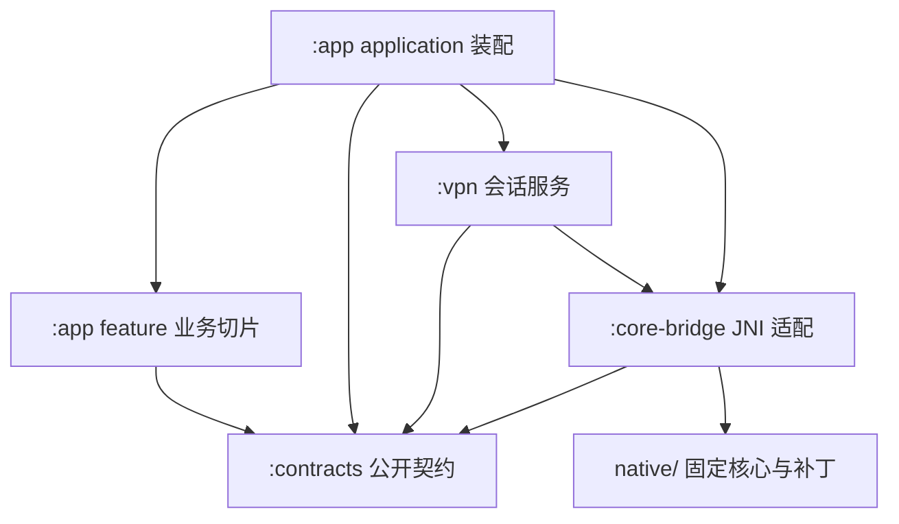

# Chuanmen 技术架构与关键契约

架构设计基线 1.0 · 外部资料核对日期：2026-10-11（Asia/Shanghai）。文中的上游“当前/最新”按该日期理解，实际依赖以仓库配置为准。

本文规定目标边界、状态归属、平台适配与验证门槛。现有 demo 与纯领域契约见 [开发环境](../development/setup.md)，目录演进见 [目录边界 ADR](adr/0003-directory-boundaries.md)，实施状态见 [路线图](../plan/ROADMAP.md)。正式 VPN/JNI 尚待实现；交互原型、demo 和 P00 探针分别支撑各自范围的验证。

本文的证据等级为：**已证实**指研究时读取的一手文档或固定版本源码；**拟议**指本项目应建立的设计与接口；**待实测**指必须由所选构建产物与设备实验确认的行为。读取记录见 [Android 与核心证据](../research/android-core-evidence.md)，后续实测结果见 [P00 报告](../verification/p00/report.md)；源码事实不能代替产品验收。

## 1. 架构结论

采用 **Kotlin + Jetpack Compose + Android VpnService + 固定版本 EasyTier Rust 核心**。应用通过本项目的窄 JNI 桥访问核心，由服务统一持有运行会话；页面通过类型化状态观察服务。初期使用单进程、单个活动 VPN 会话，允许保存和编辑多个网络配置。

核心优先复用上游 `easytier` 原生宿主、实例管理和 `easytier-contrib` 中的 FFI/JNI 能力。不要为了界面重写组网协议，也不要直接依赖不断变化的 Rust 内部类型到每个 ViewModel。`easytier-core` 在研究时主干已拆为便携核心，直接嵌入它还意味着承担宿主适配责任；本项目先复用完整原生宿主，再补 Android 必需的边界。P00 已提供该方向的限定构建与真机依据，正式接入和补丁仍须产品评审。[ET-01]、[ET-04]

### 1.1 上游版本必须先选定一份

| 2026-10-11 读取对象 | 研究时已证实状态 | 对本项目的影响 |
|---|---|---|
| 最新非预发布 `v2.6.4` | 2026-05-12 发布；标签当前指向 `8428a89d2dabc94c97d370ec607c6ca142473626` | 作为稳定发布比较基线；不能假设有主干新接口 |
| 当前 `main` | `7592951b808c4839cb9d77cc4bc642f124915951`，提交时间 2026-10-10 17:35:33 UTC；manifest 的核心版本为 `2.7.0` | 是研究快照，不能当作已发布的稳定 2.7.0 |
| 原型配置语义快照 | 原型目录记录 `83baead0599110bee0d47f4c70b63b23753252a7`，官网部署另以文件 SHA-256 固定 | UI 范围证据与本次核心主干不是同一份版本 |

P00 的固定核心来源、实验补丁决策与遗留限制以报告为准。正式接入须绑定明确来源，核对补丁批准、回退和回归安排；桥接契约、默认值、配置编码、构建 features 和测试 fixture 都绑定该来源。不得用稳定版 `.so` 配合主干 RPC schema，也不得把官网 UI 自动等同于所选核心版本。[ET-01]、[ET-02]、[ET-03]

## 2. 工程边界与依赖

采用包级业务切片与独立运行模块。当前为 `:app -> :contracts`；`:vpn`、`:core-bridge` 在实际实现与消费者就绪后建立。详细目录约定见 [目录边界 ADR](adr/0003-directory-boundaries.md)，当前 demo 边界见 [装配 ADR](adr/0004-demo-assembly.md)。

| 模块 / 目录 | 唯一职责 | 不应承担的职责 |
|---|---|---|
| `:app` | 应用装配、Compose 与业务切片；配置状态/校验/存储/codec、日志存储与外观偏好归各自能力 | 页面不直接读 TUN、调用 JNI、访问 DAO 或维护第二份连接真相 |
| `:contracts` | 实际跨模块使用的纯 Kotlin 接口、不可变模型与快照，如 ProfileRepository、SessionController、CoreEngine | 不依赖 Android、Compose、Room 或 Rust 类型，不收纳切片私有草稿与校验 |
| `:vpn` | VpnService、会话命令串行化、授权结果、网络变化、TUN 建立与替换、通知与恢复 | 不决定表单布局，不反向依赖 app 存储实现，不解析任意上游 JSON |
| `:core-bridge` | JNI 包装、版本握手、DTO 解码、上游错误映射、回调线程与资源契约、真实 CoreEngine 适配 | 不拥有页面导航、不直接保存用户表单 |
| `native/` | 固定上游引用、最小补丁、本项目桥接源码、ABI 与 feature 清单、原生构建和符号产物 | 不跟踪浮动主干、不复制一份无人维护的完整网络协议 |
| 各模块测试目录 | fake engine、固定时钟、DTO/配置样本、设备场景与测试支持；实际跨模块复用后再提取 `:testing` | 不在 real 失败时返回模拟成功 |

配置切片实现 `ProfileRepository`，应用装配层将其注入服务；VPN 无需依赖 app 实现。配置保存与本地改名属于配置业务，实际 Apply 与重连由服务串行执行，并通过回执确认 applied 修订。跨切片通过公开契约协作，真实会话只有服务一个来源。

操作的状态、校验、用例和测试聚合到所属切片；无需给每个简单读写创建 UseCase。界面采用单向数据流：状态向下、用户意图向上；公开只读 StateFlow，内部可变状态不泄漏。该方向符合 Android 官方架构建议，具体模块数量是本项目的取舍。[A-09]

### 2.1 为什么先单进程

Android 默认让应用组件处于同一进程；Service 不自动拥有专用线程。独立 `:vpn` 进程可隔离 UI 与 native 崩溃，但会增加 Binder 协议、进程死亡重绑定、数据库跨进程访问、回调背压和两套状态恢复成本。[A-08]

本项目先用同进程、独立服务作用域、串行会话控制器、后台 JNI 调度。UI 关闭和 Activity 重建不结束服务会话。只有 P00/P06 的崩溃实验、长时运行数据或明确产品要求证明隔离收益后，才引入独立进程；届时增加 ADR，禁止以静态单例“共享”两个进程的状态。无论是否分进程，native 的 release panic/崩溃都不能靠 Kotlin `try/catch` 当作已恢复；UI 必须能从实际服务状态重新建立显示。

## 3. 数据模型：本地名称、保存内容与运行内容分开

### 3.1 配置身份

| 概念 | 建议模型 | 规则 |
|---|---|---|
| 本地配置 ID | `ProfileId`，随机 UUID | 永久主键；重命名不变 |
| 本地配置名称 | `ProfileMetadata.localDisplayName` | 仅供本机识别；新建可空，留空使用网络名称；修改不触发重连 |
| EasyTier 网络名称 | `CoreConfig.networkIdentity.networkName` | 入网参数；与本地显示名独立 |
| 本设备名称 | `CoreConfig.hostname` | 对等设备看到的名称；按核心能力决定是否需重连 |
| 核心实例标识 | `CoreInstanceId` / 内部实例名 | 由适配层管理且稳定映射 ProfileId，不使用用户可改显示名作为句柄 |
| 运行会话 | `SessionId` + `generation` | 每次连接或受控重连换代；所有异步响应带代号 |

原型 `profile.label` 在原生工程中只映射到 `ProfileMetadata.localDisplayName`，不同时保留 `displayName` 或 `label` 作为第二份可写字段。重命名只更新元数据事务。还原上次运行配置、导入核心 TOML、丢弃草稿，都不得覆盖用户自己起的本地名称。复制配置生成新的 ProfileId；导入时不能让文件中的 `instance_name` 直接接管内部句柄。

### 3.2 四类状态

| 状态 | 来源与生命周期 | UI 使用方式 |
|---|---|---|
| `DraftConfig` | 当前编辑内容、原始输入文本、字段错误；允许暂时无效 | 基础配置与完整配置共享同一份草稿 |
| `SavedConfig(revision)` | 已完成校验并持久化的配置与 Android 策略 | 用于下次连接；保存不等于运行生效 |
| `AppliedConfig(revision, sessionId)` | 服务确认当前会话实际使用的配置版本 | 用于比较“待应用”；断开后不继续声称当前仍在应用 |
| `SessionSnapshot` | 服务与核心回执、TUN 状态、采样时间、连接路径 | 首页连接状态与设备状态的唯一运行来源 |

本地偏好与配置可用 Room/DataStore 分工：Room 存多配置、修订与迁移；DataStore 存主题、动态色等小量应用偏好。不要在两个存储里分别保存同一字段并相互覆盖。DataStore 不适合作为大型关系数据或日志逐行数据库，官方也区分了这类用途。[A-10]

网络密码等敏感字段必须在存储层有明确保护方案，例如 Android Keystore 管理密钥、应用私有目录保存密文；不要误称 Room/DataStore 默认加密。不要把密码写进 SavedStateHandle、Bundle、日志、崩溃附件或未脱敏 fixture。自动备份、换机恢复和用户显式导出的行为需在 P03 写清楚，避免出现恢复了密文却没有解密密钥的伪成功。Keystore 的密钥使用与提取边界见官方文档。[A-15]

## 4. 会话状态机与配置应用

状态建议包含 `Idle`、`AwaitingPermission`、`StartingCore`、`PreparingTun`、`Running`、`Reconnecting`、`Stopping`、`Failed`。`Running` 表示本机核心与 VPN 数据路径已准备完成，不保证已经找到其他设备，也不保证任意目的地址可达；“等待设备加入”是它的一种正常内容状态。

会话控制器按命令串行执行 `Connect(profileId)`、`Disconnect`、`Apply(savedRevision)`、`UnderlyingNetworkChanged`、`Revoke`，每条命令具有操作 ID。反复点击连接合并为同一操作；过期的启动回执、指标和日志不能覆盖新会话。

### 4.1 连接事务

1. 取得保存版本，执行 App 语义校验与所选核心的解析验证；检查构建能力和平台策略。
2. 由 UI 完成 `VpnService.prepare()` 的系统授权流程。拒绝后返回可重试状态，保留配置。
3. 从允许的用户操作或系统路径启动前台服务，及时建立持久通知；核心的阻塞初始化不在主线程执行。
4. 安装 Android socket protection 能力，启动一个核心实例。保护钩子必须在可能创建外层连接前就绪。
5. 等待可信的本机地址和有效路由方案；DHCP 成功与端口监听成功分别记录，不能从模拟 IP 或默认值推断。
6. 用 `VpnService.Builder` 建立 TUN，将 fd 借给核心，并等待**本项目需要新增或验证的 TUN 安装回执**。
7. 只有核心启动、TUN 建立、对应代次的 fd 安装和平台参数应用均确认后，发布 Running 与 AppliedConfig；没有对等设备时展示等待状态。

每一步失败都有明确资源回收路径。不能把 `runNetworkInstance()` 或 `setTunFd()` 返回 0 当作整个连接事务成功。当前主干 `setTunFd()` 最终只是将 fd 放入异步安装队列；安装任务后续仍可能失败。[ET-03]、[ET-05]

### 4.2 应用配置的默认行为

默认采用**校验 → 保存新修订 → 受控重连 → 回执确认**。这是为了得到可验证行为，不声称上游所有配置都能热更新。

当前主干存在 `ConfigRpc.PatchConfig`，但 patch 模型只列出部分字段，且 Android 地址、DNS、应用名单与 TUN 路由需要独立同步。稳定版是否可通过本项目桥调用、字段间是否事务一致、失败能否回滚，都必须逐项实测。只有进入版本化 `liveApplyAllowlist` 的字段才允许无重连应用；其余字段继续受控重连。[ET-09]

“仅保存”不更改活动会话；“保存并应用”对当前活动配置执行事务。失败时保留新保存版本、显示失败原因与重试入口。恢复上次运行版本应是明确操作，不静默丢弃用户修改；若恢复成功，以实际恢复回执更新状态。只有当前确实存在同配置的活动会话且版本不同，才显示“更改待应用”。

配置页正常状态不显示“已应用”横条；未保存、待应用、错误或处理中才出现底部操作区。成功使用短暂反馈；失败与待处理状态持续可见。复制 IP 使用统一图标反馈，Android 13 及以上应避免与系统剪贴板反馈重复提示，原型 Toast 不能逐字照搬为双提示。[A-13]

## 5. TUN、socket 与网络变化的硬契约

### 5.1 fd 所有权

**本项目采用 Kotlin 持有、native 借用的所有权模型。**上游稳定版与本次主干的 mobile TUN 路径都设置 `close_fd_on_drop(false)`，这说明不能假设 native 析构会替 Kotlin 关闭 fd。[ET-06]

| 对象 | 所有者 | 必须满足的约束 |
|---|---|---|
| `ParcelFileDescriptor` | VpnService / TunCoordinator | 建立后保持强引用，负责最终关闭 |
| 借给核心的整数 fd | native 在当前代次内借用 | 禁止自行关闭或保存到下一代会话；桥文档写明借用期 |
| TUN 读取任务 | 单一 native 数据路径 | UI、Kotlin 图表和日志代码不得另开读取器 |
| TUN 写入任务 | 同一 native 路径 | 只统计成功写入的数据；失败不计为接收完成 |
| fd 替换 / 停止 | TunCoordinator 串行执行 | 停止旧读写并收到完成回执后，关闭旧 PFD；不得仅凭入队回执关闭 |

不要对 PFD 调用 `detachFd()` 后又继续按借用模型管理，也不要两边都 close。fd 是可复用整数；旧异步回调若在关闭后继续操作，可能误伤后来复用同一编号的资源。每次替换携带 sessionId、generation 和 attachmentId，完成回执只能匹配当前 attachment。

研究时上游 `setTunFd(-1)`/非正值路径可用于移除的内部行为不能自动当稳定公共协议。P00 的所有权观察只支撑限定探针；正式桥须明确提供 `detachTunAndAwait()` / `stopAndAwait()` 等语义并验证。如果无法安全证明关闭时序，P02 不得过关。

### 5.2 外层连接必须避免回环

Android `VpnService.protect(fd)` 用于让外层网络 socket 绕过 VPN；调用可能失败，并且不会替调用方关闭 socket。没有正确保护时，发往被 VPN 路由覆盖的地址可能重新进入 TUN，形成回环。[A-02]

本次主干已有 `NativeSocketProtector` Rust 钩子：它的 future 应在保护真正完成后返回；错误会阻止相应 socket 创建流程继续。但已读取的 JNI facade 没有对应的 Android callback 注册入口，而且未安装 protector 时内部函数会直接返回成功。因此 **“存在 protect 的 Rust 源码”不等于 JNI App 已受保护**。[ET-07]

本项目桥需要实现并验证：native 创建相关 socket → JNI 调用服务的 protect → 检查 Boolean 结果 → 返回确认 → 才继续 bind/connect/listen 或暴露 accepted socket。必须覆盖 TCP、UDP、重连、DNS/STUN、监听与接受连接、所启用的 QUIC/KCP 等路径；不能靠“排除 App 自身”掩盖漏掉的路径。保护失败和服务撤销必须使该次连接失败，不静默放行。

若需要将 socket 固定到具体物理网络，`Network.bindSocket()` 与 `setUnderlyingNetworks()` 是另一组职责；仅调用后者不会迁移现有 socket。官方说明应在实际底层网络集合改变时更新；默认不绑网络时其语义不同。[A-02]

### 5.3 路由、DNS、IPv6 与应用名单

`TunPlan` 是从已保存配置、核心实际地址/已学习路由和 Android 策略编译得到的**平台计划**，包含 address、routes、MTU、DNS、应用白名单或黑名单及 IPv6 策略。UI 不能把字符串直接逐条交给 Builder 而跳过语义校验。

应用允许名单与排除名单互斥，改变名单需要重新建立 VPN 连接；应用卸载后要显式处理缺失包名。网络地址或代理路由变化亦应进入相同的 TUN 协调路径；配置变化和 DHCP 变化不可同时建立两个相互覆盖的 TUN。[A-01]

IPv6 必须有可验证的支持或阻断策略，不能只显示一个“启用 IPv6”开关却不知道流量从哪出去。DNS 的系统、指定与核心名称解析需定义优先级，验证 VPN 内域名、系统 Private DNS、无 IPv6 网络、IPv6-only 网络和退出节点组合。路由覆盖只说明流量选择，不证明对端确实提供出口服务。

物理网络变化由 ConnectivityManager 回调汇入服务；去抖并丢弃过期事件。Wi-Fi ↔ 蜂窝切换、短暂断网、设备休眠都应先更新实际可用网络，再决定恢复连接。网络 `onAvailable` 不能替代能力与 LinkProperties 的后续变化；回调和同步查询之间的时序须测试。[A-11]

## 6. 本项目 CoreEngine 契约

以下为**拟议接口能力**，并非上游当前 JNI 已完整提供的方法名。

| 契约 | 最小输入 / 输出 | 验收重点 |
|---|---|---|
| `getBuildInfo()` | bridge ABI、core version、完整 SHA、feature 集合、schema 版本 | APK 与 native 来源一致；不兼容时明确报错 |
| `validateConfig()` | canonical TOML → 结构化结果 | 解析成功不替代 Android 语义与运行可行性校验 |
| `start()` / `stopAndAwait()` | 配置、SessionId → 生命周期事件 / 完成回执 | 同时最多一个活动实例；重复停止幂等 |
| `attachTunAndAwait()` / `detachTunAndAwait()` | 借用 fd、attachmentId → 安装或移除回执 | 明确借用期和失败回收；不等价于原始 setTunFd 的队列回执 |
| `setSocketProtector()` | 平台回调 → 安装状态 | 严格等待保护成功；回调不依赖 Activity |
| `observeSnapshot()` | 统一会话、本机信息、peers/routes、来源时间 | DTO 可缺失；当前快照有代次和单调序号 |
| `readTunCounters()` | 本机双向累计字节/包、采样时间 | 只有成功 TUN I/O 计数；计数重置可识别 |
| `observeCoreLogs()` | 有界日志事件流 | 背压、丢弃计数、脱敏、取消；不阻塞数据面 |

上游 JSON/protobuf DTO 只出现在 bridge 内。外层使用领域类型，未知枚举保留原值与 Unknown 展示；64 位累计值不先转成 Float/Double 再存储。JNI 的线程附着、全局引用释放、异常到错误类型的映射、字符串编码与回调取消都要有契约测试。

在同一应用入口 `.so` 中保持一个受控 Rust runtime 和实例缓存。当前 FFI 使用进程静态上下文；构建脚本即使生成多个 `.so`，也不能无审计地同时加载出互不共享的单例。P00 检查最终依赖和动态符号，P02 证明 UI 重建不会重新初始化核心。[ET-10]

## 7. 配置目录与 Android 能力

官网助手决定用户认可的**编辑范围**；固定核心版本决定编码与运行语义；Android 适配与构建 features 决定可用能力。三者需要在 P00/P03 形成一张可机器校验的映射表，不能合并为“官网有这个字段，所以 Android 已支持”。

当前原型的 44 个编辑单元是 **37 个官网对应核心编辑项 + 7 个 Android 自有选项**。一个编辑单元可包含多个嵌套字段，因此它既不等于 44 个原生参数，也不是已经验收的功能数量。原型的字段默认值与隐藏原因必须在所选版本上复核。

建议字段定义至少包含：稳定字段 ID、官方来源 key、核心 TOML 路径、编辑类型、默认值来源版本、缺省/显式空/显式值三态、校验器、依赖、Android 适用性、编译 capability、应用方式和验证 fixture。搜索与完整配置使用同一过滤结果；平台不适用项不以灰色占位污染列表。导入遇到未知或不支持项，保留原始数据并明确说明，不能在一次保存时静默删除。

### 7.1 重审原型隐藏项

原型显示的 37 + 7 不是生产能力的永久上限。P00 对原型曾隐藏的 8 项统一标记 `requires_platform_review`，再按事实分为平台托管、在本模式不适用或暂未适配；“暂未适配”不能写成“Android 不需要”。

| 原型隐藏项 | P00 必须核对的归属 |
|---|---|
| `flags.dev_name` | VpnService 的 TUN 名称由平台管理；通常属于托管项 |
| `flags.bind_device` | 物理网络选择应由宿主控制；复核所选核心版本的新接口，不能沿用旧 native host 理由 |
| `flags.multi_thread` | 共享 runtime 的进程级策略；通常不作为单网络表单项 |
| `flags.use_smoltcp` | 用户态协议栈的构建/宿主选择；复核新版本语义后由适配层托管 |
| `flags.no_tun` | 本产品当前固定免 Root VPN 模式；若未来提供独立代理模式，需重新评审，不能说 Android 技术不支持 |
| `flags.proxy_forward_by_system` | 普通免 Root 模式不提供 Linux 内核转发管理；用户态代理是另一实现路径 |
| `flags.enable_udp_broadcast_relay` | 当前已读捕获路径属于 Windows；若上游提供 Android 实现，重新进入能力评估 |
| `ipv6_public_addr_auto` | 当前是尚未完成公网 IPv6/TUN 同步适配，属于能力欠缺待评审，不能以“不需要”永久排除 |

P00 记录每项的新源码依据和结论；P05 将仍属于合理产品范围的待适配能力建立独立验收。如果证据和当前原型冲突，以已批准的产品范围与实际能力评审更新目录，不直接删掉用户数据。

“基础配置”与“完整配置”共享草稿。基础页保留网络名称、网络密码、连接节点以及地址分配摘要；本地配置名称在共用元数据区域编辑。完整页按同级分组展开、支持同页搜索定位。监听、映射监听、P2P、ACL、代理、出口、Portal 等低频功能不能仅因不常用被删除；也不能在真实后端没有接好时显示可启动成功。

Portal、手机作为出口、用户态子网代理、SOCKS5、端口转发分别建立能力验收：至少核对 Cargo features、实际监听地址、socket 保护、入站可达性、路由回程、权限和耗电。当前主干已有编译能力校验并可在构建缺少能力时报错，这只是核心构建事实；Android 实用能力仍需 P05 真机证明。[ET-11]

## 8. 可观测性：流量、设备与日志

### 8.1 首页固定 60 秒趋势

首页图表统计口径固定为**本机 VPN/TUN 成功传输的 IP 数据**，两条曲线与当前上下行速率，最近 60 秒，初始候选采样周期 1 秒。无拖动取值、悬浮读数、详情页、时间选择或图例开关。

计数放在现有 native TUN I/O 成功路径中：从 TUN 读出为本机上行，写回 TUN 成功为本机下行。不要为画图在 Kotlin 第二次读取同一个 fd，这会与核心争抢报文。对同一 fd `dup()` 也不会产生独立的报文镜像。当前已读上游 mobile TUN 路径可定位 I/O 包装点，但未证实有可直接供本项目调用的完整 TUN 计数 API，需 P02/P04 适配。[ET-06]

速率为同一会话中累计字节差除以单调时间差；更换会话、计数回退、采样间隔异常或采样失败时断开曲线，不制造负值/尖峰。不活动但采样有效时绘制 0，缺失样本画断点。仅持有固定窗口，UI 不可见时停止高频重绘；服务继续必要的运行采集。

该曲线能说明本机有流量经过 VPN 数据路径，但不能证明某个 App 已正确分流、远端已收到业务数据或所有配置均生效。DNS、系统流量也可能经过 TUN。首页连接、路由状态和业务趋势独立表达，不把全 peer 隧道字节（含保活、协议开销或第三方中继）冒充本机应用流量。

### 8.2 设备与路径指标

| 展示内容 | 已证实可参考的数据 | 产品口径与缺失处理 |
|---|---|---|
| 设备身份 / 地址 | Route、NodeInfo、peer ID、instance ID | 用稳定身份关联；地址可变；缺失显示“暂不可用” |
| EasyTier 版本 | `Route.version` / `NodeInfo.version` | 显示对端报告值；本机额外保留打包 SHA |
| NAT 类型 | `StunInfo.udp_nat_type` 与 `tcp_nat_type` | TCP/UDP 分开，保留未知/检测中，禁止一概写成对称 NAT |
| 直连 / 中继 | routes 的 next hop 与 peer connections | 设备可能多路径；以当前有效路径说明，不能只按设备在线判定 |
| 收发字节与包数 | `PeerConnStats.rx/tx_bytes`、`rx/tx_packets` | 是连接/邻居口径，按连接重置；经中继的远端无端到端值时不能挪用中继邻居总量 |
| 时延 | `latency_us` 与 path latency 的相应来源 | 标明直连探测或路由路径；不混合不同单位 |
| 丢包 | `PeerConnInfo.loss_rate` 来自内部 ping/pong 探测 | 命名“探测丢包率”；不是业务包丢失比例，也不是 TCP 重传率 |

以上字段在本次主干 protobuf 与实现中已证实存在，具体稳定版本的 RPC 暴露方式仍以 P00 为准。`loss_rate` 实现由探测成功/失败窗口统计得来，不能用收发字节相除另造“丢包率”。设备列表与详情不放相关日志入口。[ET-08]、[ET-15]、[ET-16]

### 8.3 两个日志来源

来源枚举固定为 EasyTier 与 App。EasyTier 来源包含核心运行、连接和协议错误；App 来源包含授权、服务、配置事务、TUN、平台适配和 UI 操作错误。日志记录至少包含序号、墙钟时间、单调时间、来源、等级、模块、SessionId、可空 ProfileId、脱敏消息和结构化错误码。

当前 `LoggerRpc` 只提供获取/设置日志级别，不能当作日志流接口。JNI 当前还有 android_logger 初始化，而核心有自身日志设施；必须确定单次初始化顺序和真实日志 sink，避免一个全局 logger 抢先安装导致另一来源丢失。优先在固定核心构建接入有界 sink / 回调，或受控读取应用私有滚动日志文件；不依赖读取其他应用 logcat。[ET-12]、[ET-17]、[ET-18]

建议初始预算为内存有界环形缓冲、有限磁盘轮转、保留期上限；具体容量由 P04 压测确定。队列满时丢弃低优先级记录并报告丢弃数，不阻塞 VPN 数据面。采集级别与页面过滤分开：页面筛选 Debug 不能恢复从未采集的 Debug。用户上滑阅读时保留位置，新日志显示计数，点击后再恢复跟随。

密码、密钥、认证令牌、完整含凭据 URL 与原始配置不得进入普通日志。导出前再次脱敏；导出范围和来源由用户选择，文件通过系统分享机制交付。原型中双来源和阅读行为继续作为 UI 验收基线。

## 9. Material 3 Expressive、Monet 与原生 UX

本次官方发布页列出的稳定 Material3 为 **1.4.0**，最新候选为 **1.5.0-beta01（2026-10-07）**。1.4.0-beta01 曾移出标记为 `ExperimentalMaterial3ExpressiveApi` 的公开 API，后续沿 1.5 线发展。因此不能把“Compose 支持 Expressive”写成“所有 Expressive API 已稳定”。[A-03]

建议以稳定组件实现当前已经确认的页面、颜色角色、字号层级、形状和适度动效，保持 Expressive 视觉方向；需要 1.5 特有 API 的组件逐个登记，限制 opt-in 范围并在设计系统包装内隔离。P00/P01 冻结实际版本组合，P07 再核对发布状态。不得只为某个装饰动效把整个项目无评估地切到浮动 beta。

Monet 在 Android 12+ 使用 `dynamicLightColorScheme` / `dynamicDarkColorScheme`，用户可关闭；更旧系统回退本项目固定明暗主题。所有状态色通过语义角色表达，不用单一颜色承担状态含义；图表两条线同时有方向标签。动态色来自系统方案，不申请读取壁纸的额外权限。[A-04]

首页将在线设备摘要放入虚拟网络卡片，流量曲线直接可见；流量范围在当前网络设置中。设备详情优先同页展开或一个紧凑详情容器，避免连续跳转。配置操作区仅在有事可处理时出现。触控目标至少 48 dp、字体放大、TalkBack、键盘/IME、手势返回和窄屏需在 P04/P06 验证。[A-14]

原生图表建议用 Compose Canvas 绘制固定 60 点窗口，避免为非交互小图引入大型图表 SDK。其可访问性提供当前值和趋势摘要；不把每秒刷新设置为不断打断读屏的 live region。原型 HTML 不是 WebView 上线方案；真实 App 不需要联网加载 D3 或 Lucide CDN。

## 10. Android 构建、前台服务与发布边界

### 10.1 SDK 与 ABI

模板 SDK 声明以 app 构建配置为准，安装入口见开发环境。下表保留研究基线与产品接入约束，不代替现有配置或兼容性实测。

| 项目 | 本次已核事实 / 建议 |
|---|---|
| 最低系统 | 研究曾提出 `minSdk 26` 候选；现有模板声明见 [app 构建配置](../../app/build.gradle.kts)。正式 native 最低系统须根据核心、JNI、依赖与设备矩阵评审，模板值不能当作产品兼容性验收 |
| Play target 门槛 | 官方当前要求 2026-08-31 起新应用/更新面向 API 36+；P07 按实际发布日期重新检查 |
| 系统测试范围 | 研究时 Android 17 / API 37 已发布；API 36 商店门槛不等于最新系统。现有模板 compile/target SDK 以配置为准，正式产品须补齐相应设备验证 |
| 正式 ABI | 首先 arm64-v8a；x86_64 用于模拟器验证；是否提供 armeabi-v7a 由明确设备需求决定 |
| 工具链 | Gradle wrapper、AGP、Kotlin、Compose BOM/Material3、JDK、NDK、Rust 均锁定；选择兼容组合，不从旧参考目录抄版本 |

以上 Play 门槛与 Android 17 事实来自原核对日期的官方资料。P00 只验证报告列明的矩阵，正式产品版本以配置和后续兼容性记录为准；发布时重新核对政策。[A-05]、[A-12]

### 10.2 16 KB 页面

正式产品接入 native `.so` 后，必须同时检查 ELF 段对齐、APK/AAB 打包对齐、所有依赖库与运行时页面大小假设。研究时官方文档给出 AGP 8.5.1+ 的打包支持、NDK r28+ 默认 16 KB ELF 对齐，但“用了新 NDK”不能证明 Rust 链接产物和预编译库都合规。P00 记录实验构建条件，未完成 16 KB 运行验收；P02 检查产品产物，P07 验证从 AAB 生成的 APK 在 16 KB 设备/模拟器安装并执行真实 JNI 路径。兼容模式能运行不替代原生支持验收。[A-06]

### 10.3 前台服务

VPN 作为持续可感知的用户任务运行。Manifest 声明 VpnService、`BIND_VPN_SERVICE` 保护与当前 API 要求的前台服务权限/类型，确保系统可以正确发现服务，同时关闭无必要的其他导出组件。

研究时官方将已在系统 VPN 设置中配置的 VPN App 列为 `systemExempted` 的适用情形；不满足条件会抛出异常。已读上游 Tauri 示例使用 `specialUse`，它不是本项目可无条件照抄的政策结论。正式接入须基于 P00 的限定场景观察，补齐授权前后与系统启动路径，选择满足条件的类型；如需 `specialUse`，应提供真实用途说明并完成 Play 声明。不要用 `dataSync` 或 `shortService` 冒充长时 VPN。[A-07]、[ET-13]

通知显示当前配置、连接状态和明确动作，进入 App 后读取同一会话。重连不反复响铃。始终开启、系统撤销、锁定模式、其他 VPN 接管和开机恢复各有不同触发条件；没有通过完整验证前，不宣称支持 Always-on，也不承诺永远不会被系统终止。官方 VPN 文档明确系统与应用各自的生命周期责任。[A-01]

### 10.4 许可证与可追溯产物

官方仓库元数据识别为 LGPL-3.0，已读取的核心 LICENSE 为 LGPL v3 文本。发行方案应保存所用源码/补丁、构建说明、许可证文本、第三方 notices 和对应 native 产物哈希，并对链接、替换/重新链接及源码提供方式建立发布检查；不能因为主 App 使用 Kotlin 或核心是 `.so` 就自动忽略许可证义务。具体许可证方案需在首次对外发布前确认，不把本文件当成“整个 App 必须选某许可证”的法律结论。[ET-14]

## 11. 验证与阶段门槛

下表是技术验收目标，具体完成状态和边界以路线图及相应报告为准。P00 的限定通过不表示最低系统、全部 ABI 或 16 KB 等范围外条目已通过；没有完成的条目不能由 UI 演示或源码存在代替。

| 阶段 | 技术完成定义 |
|---|---|
| P00 | 选定唯一核心版本与 SHA；证明 ARM64 构建、最低系统 JNI 加载、protect 回执、TUN 借用/关闭方案与地址路由获取可行；冻结接口样本与 capability 初稿 |
| P01 | 按实际建立的模块依赖与 fake engine 可运行；debug/demo 可以离线演示，真实变体不自动回退 fake；构建与检查命令在 CI 可重复 |
| P02 | 真机免 Root VPN 建连、业务流量经过 TUN、撤销/停止/重复启动安全；fd、线程、回调和 runtime 不泄漏；16 KB 原生产物检查通过 |
| P03 | 字段语义、默认值、三态、配置序列化与 codec 往返、localDisplayName 与三版本状态有自动化证据；用户级文件导入导出在 P05；保存不会偷偷重连，应用失败不丢数据 |
| P04 | 当前原型交互转为真实 Compose；双来源日志、60 秒 TUN 趋势、设备字段和不可用状态来自真实 bridge；无伪造 0 或探测口径混淆 |
| P05 | 每个高级能力都有真机拓扑、构建 feature、路由/入站/回程及保护覆盖证据；经证实不适用或平台托管项在 UI 和搜索中一致隐藏，适用但未实现项保留为阻塞 |
| P06 | Wi-Fi/蜂窝、休眠、系统撤销、后台/进程恢复、DNS/IPv6、应用名单变化与长时运行验证；决定是否需要独立进程 |
| P07 | release 签名产物的安装与回归、AAB 生成 APK 的 16 KB 测试、发布政策/许可证/隐私/符号产物复核；发行说明写明已支持范围 |

正式产品至少保留三类测试：纯 JVM 的配置/状态机测试，bridge 的固定 DTO 与 JNI 契约测试，受控测试网络上的真机端到端测试。测试使用单调时钟与明确代次，覆盖缺失、超时、取消、乱序和旧响应。吞吐、耗电、连接耗时与内存目标以相应产物的实测基线为准，再在 P06 设回归预算；P00 单轮测量不推广为正式产品性能。

## 12. 必须形成的 ADR

1. 所选 EasyTier tag/commit、补丁策略与升级方式。
2. 单进程的理由；何种观测结果会触发独立 VPN 进程。
3. Kotlin 持有 TUN、native 借用、替换/停止回执与异常关闭顺序。
4. socket protect 的覆盖范围、失败策略和底层网络绑定规则。
5. 核心配置与 Android TunPlan 的编译方式、热更新允许名单。
6. TUN/peer/探测指标的各自口径、重置与缺失语义。
7. 日志初始化、sink、脱敏、背压和保留预算。
8. Material3 稳定版本与局部 Expressive beta API 的使用边界。
9. 敏感数据、备份/恢复与显式导出。
10. native 构建、16 KB、许可证与可重现发布。

ADR 应短而具体：背景、已验证事实、候选方案、决定、代价、验证记录和重新评估条件。已选决定由代码/测试持续维护；研究结论变化时同步修改，不保留互相矛盾的两套说明。

[ET-01]: https://api.github.com/repos/EasyTier/EasyTier/releases/latest
[ET-02]: https://api.github.com/repos/EasyTier/EasyTier/git/ref/tags/v2.6.4
[ET-03]: https://github.com/EasyTier/EasyTier/blob/7592951b808c4839cb9d77cc4bc642f124915951/easytier-contrib/easytier-android-jni/src/lib.rs
[ET-04]: https://github.com/EasyTier/EasyTier/blob/7592951b808c4839cb9d77cc4bc642f124915951/easytier/src/host_runtime.rs
[ET-05]: https://github.com/EasyTier/EasyTier/blob/7592951b808c4839cb9d77cc4bc642f124915951/easytier/src/instance/runtime_host/tun_mobile.rs
[ET-06]: https://github.com/EasyTier/EasyTier/blob/7592951b808c4839cb9d77cc4bc642f124915951/easytier/src/instance/virtual_nic.rs
[ET-07]: https://github.com/EasyTier/EasyTier/blob/7592951b808c4839cb9d77cc4bc642f124915951/easytier/src/socket_protector.rs
[ET-08]: https://github.com/EasyTier/EasyTier/blob/7592951b808c4839cb9d77cc4bc642f124915951/easytier-proto/proto/api_instance.proto
[ET-09]: https://github.com/EasyTier/EasyTier/blob/7592951b808c4839cb9d77cc4bc642f124915951/easytier-proto/proto/api_config.proto
[ET-10]: https://github.com/EasyTier/EasyTier/blob/7592951b808c4839cb9d77cc4bc642f124915951/easytier-contrib/easytier-ffi/src/state.rs
[ET-11]: https://github.com/EasyTier/EasyTier/blob/7592951b808c4839cb9d77cc4bc642f124915951/easytier-core/src/instance/build_capabilities.rs
[ET-12]: https://github.com/EasyTier/EasyTier/blob/7592951b808c4839cb9d77cc4bc642f124915951/easytier-proto/proto/api_logger.proto
[ET-13]: https://github.com/EasyTier/EasyTier/blob/7592951b808c4839cb9d77cc4bc642f124915951/tauri-plugin-vpnservice/android/src/main/java/TauriVpnService.kt
[ET-14]: https://github.com/EasyTier/EasyTier/blob/7592951b808c4839cb9d77cc4bc642f124915951/easytier/LICENSE
[A-01]: https://developer.android.com/develop/connectivity/vpn
[A-02]: https://developer.android.com/reference/android/net/VpnService
[A-03]: https://developer.android.com/jetpack/androidx/releases/compose-material3
[A-04]: https://developer.android.com/develop/ui/compose/designsystems/material3
[A-05]: https://developer.android.com/google/play/requirements/target-sdk
[A-06]: https://developer.android.com/guide/practices/page-sizes
[A-07]: https://developer.android.com/develop/background-work/services/fgs/service-types
[A-08]: https://developer.android.com/guide/components/processes-and-threads
[A-09]: https://developer.android.com/topic/architecture/recommendations
[A-10]: https://developer.android.com/topic/libraries/architecture/datastore
[A-11]: https://developer.android.com/develop/connectivity/network-ops/reading-network-state
[A-12]: https://developer.android.com/blog/posts/android-17-is-here

[ET-15]: https://github.com/EasyTier/EasyTier/blob/7592951b808c4839cb9d77cc4bc642f124915951/easytier-core/src/peers/conn/peer_conn_ping.rs
[ET-16]: https://github.com/EasyTier/EasyTier/blob/7592951b808c4839cb9d77cc4bc642f124915951/easytier-proto/proto/common.proto
[ET-17]: https://github.com/EasyTier/EasyTier/blob/7592951b808c4839cb9d77cc4bc642f124915951/easytier-contrib/easytier-android-jni/src/logger.rs
[ET-18]: https://github.com/EasyTier/EasyTier/blob/7592951b808c4839cb9d77cc4bc642f124915951/easytier/src/common/log/mod.rs

[A-13]: https://developer.android.com/develop/ui/views/touch-and-input/copy-paste
[A-14]: https://developer.android.com/develop/ui/compose/accessibility/api-defaults
[A-15]: https://developer.android.com/privacy-and-security/keystore
